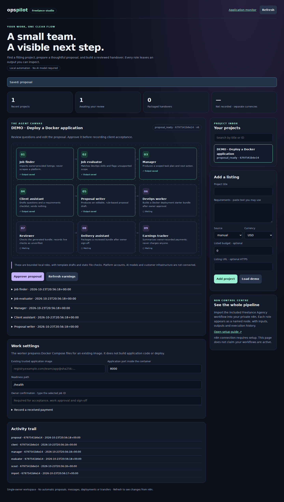
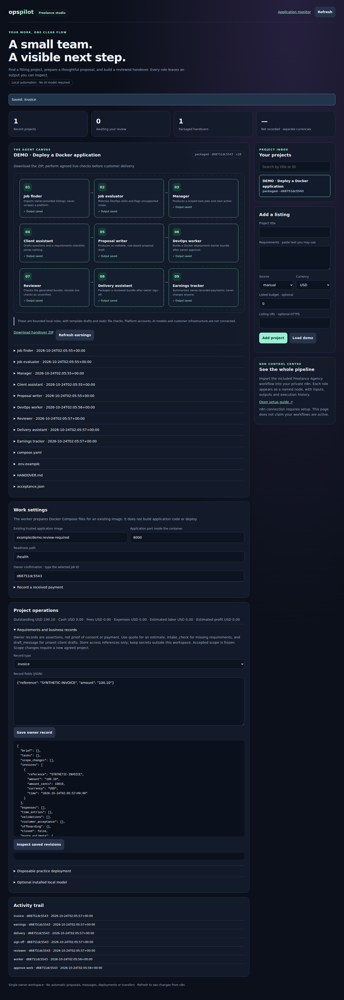

# Ops Pilot

[](https://github.com/Vishnu063/ops-pilot/actions/workflows/checks.yml)

**Know what failed. Review a repair. Check that your application responds again.**

Ops Pilot watches **one Docker application**, investigates a failed endpoint,
shows the collected evidence and a supported restart option, and verifies the
Docker state **and** application endpoint after an explicitly approved restart.

**Early preview, v0.2.** One owner, one app, one loopback dashboard. No paid AI
API, model, Kubernetes cluster, n8n or separate monitoring server is required for
this first flow. Optional local AI explanations are advisory only. This is not a
production-certified autonomous DevOps engineer.

**Verified:** Python 3.11/3.12/3.13 checks (22 unit/local-HTTP tests), installed
setup smoke, desktop/mobile Chromium acceptance, three real disposable Docker
tests and real systemd start/crash-recovery acceptance passed. A full host reboot
and external notification delivery have not been tested. [Evidence and remaining limits](docs/VALIDATION.md).
On 19 October 2026, the owner also reported a successful manual EC2 demo: nginx
returned HTTP 200, stopping `ops-pilot-demo` triggered findings, and the dashboard
reported **Recovery checks passed** after the repair flow. This is user-reported
demo evidence, not an independently captured production test. CloudLaunch/PharmaCare
was not involved.

## New: Freelance studio + n8n control centre

A separate workspace now tracks freelance projects through nine bounded local roles: Scout, Evaluator, Manager, Client assistant, Proposal writer, DevOps worker, Reviewer, Delivery and Earnings. It records outputs and explicit owner decisions, generates Docker deployment **starter files for an existing image**, checks them statically and packages a signed-off handover. No platform account, AI model, customer deployment or payment processor is connected.



**[All 50 agency steps](docs/AGENCY-ROADMAP.md)** · **[Current verification](docs/AGENCY-VALIDATION.md)** · **[Open the easy setup guide](docs/FREELANCE.md)** · **[Import the n8n canvas](n8n/freelance-agency.json)** · [Observed validation](docs/FREELANCE-VALIDATION.md)

The n8n control form supports importing a listing, viewing all project outputs and files, owner decisions, worker/reviewer execution, earnings and ZIP download. Credentials and a running backend must be configured on your own server. The original monitoring dashboard links to `/freelance`; standalone mode also works without a configured Docker target. These additions do not turn the preview into an autonomous or production-ready freelance business.

## Setup on Ubuntu / EC2

Run the server commands below in your **EC2 SSH terminal**. Run only the SSH
forwarding command in your **Mac/computer terminal**. Open login links in your
**browser**, never as shell commands. Keep AWS SSH access restricted to your IP.

Requires **Python 3.11+, Python venv, Git, curl and Docker CLI/daemon**. No GPU,
paid AI API or AI model is required. The launcher installs Python dependencies;
Docker and system packages are installed separately below. Existing working
Docker users can skip step 1.

### 1. Install prerequisites and enable Docker access

```bash
sudo apt update
sudo apt install -y git curl python3 python3-venv docker.io
sudo systemctl enable --now docker
sudo usermod -aG docker "$USER"
```

Disconnect and reconnect SSH so the Docker group takes effect. Alternatively,
run `newgrp docker` to open a shell with the new group. Start Ops Pilot from this
new shell too; a setup/server process already running in an older terminal keeps
its old permissions. Docker group membership grants powerful host access.

Check access without sudo:

```bash
docker ps -a --format 'table {{.Names}}\t{{.Status}}\t{{.Ports}}'
```

An empty table means Docker works but there are no containers on this server.
If venv creation fails, install the venv package matching your Python version.
Select another supported interpreter with `OPS_PILOT_PYTHON=python3.12` if needed.

### 2. Choose your application (or create the demo)

For an existing owned app, use its exact container name from the table and its
actual readiness URL. Do not assume a container from another EC2 is present here.
For a first test on an empty server, create this separate nginx demo:

```bash
docker run -d --name ops-pilot-demo -p 127.0.0.1:8080:80 nginx:alpine
curl -I http://127.0.0.1:8080/
```

This downloads a small web-server image and serves its default welcome page only
on EC2 loopback port 8080. It is not CloudLaunch/PharmaCare. If the first curl
gets a connection reset while nginx starts, wait a few seconds and retry curl.
Continue only after **HTTP 200**; persistent failures need investigation.
If the container name already exists, inspect it with `docker ps -a` instead of
creating it again. If port 8080 is occupied, select a free host port and use that
same port in the health URL. Do not open 8080 in the security group for this demo.

### 3. Download and configure Ops Pilot

Clone once into your chosen parent directory:

```bash
git clone https://github.com/Vishnu063/ops-pilot.git
cd ops-pilot
bash start.sh setup
```

If already cloned, enter the existing directory containing `start.sh`; do not
clone again inside it. The launcher creates `.venv` and installs this project and
its pinned Triage dependency. Setup connects one target and performs no repair.
For our demo, enter these four answers (paste plain text, without Markdown links):

| Setup prompt | Demo answer |
| --- | --- |
| Application name | `Demo App` |
| Docker context [default] | Press Enter |
| Exact container name or ID | `ops-pilot-demo` |
| Health URL (HTTPS, or local HTTP) | `http://127.0.0.1:8080/` |

For your own app, substitute its real name, Docker context, container and health
URL. If configuration already exists, setup asks you to type `replace` before
changing it. Stop an existing Ops Pilot server before changing configuration.

Start the dashboard and leave this terminal running:

```bash
bash start.sh
```

It prints a private login URL beginning with
`http://127.0.0.1:8767/login?token=...`. Copy the **complete actual URL**, including
the token. The dots are a placeholder, not a usable login. Do not share the URL,
commit it, or paste it into the EC2 shell. **Ctrl+C stops monitoring**; closing
SSH can also end this foreground process. For monitoring after logout/reboot,
install the optional background service below.

### 4. Open it on your Mac/computer

Leave the server terminal open. Open a **second terminal on your Mac/computer**
and run your usual SSH command with local forwarding added:

```bash
ssh -N -o ExitOnForwardFailure=yes -L 8767:127.0.0.1:8767 -i /path/to/key.pem ubuntu@YOUR_EC2_PUBLIC_IP
```

Replace the key path and public IP with your existing connection details. If
your normal SSH connection uses an SSH alias or a different username, reuse it.
With `-N`, the terminal stays open without a shell prompt; this is expected.
Keep this tunnel terminal open too.

Open **Safari/your browser on the same computer** and paste the full login URL
from step 3 into its address bar. `127.0.0.1` now reaches EC2 through SSH.
**Do not open port 8767 in the AWS security group.** Opening it alone cannot
reach this loopback-only preview. Public hosting is not supported in this version.

For a Linux computer running Ops Pilot locally, open the printed link directly;
no tunnel is needed. On a phone, use an SSH client supporting local forwarding.
GitHub's mobile app alone cannot run the server or establish the tunnel.

### 5. Test a failure and recovery (demo only)

First confirm the dashboard identifies `ops-pilot-demo` and shows **Endpoint
checks passed**. In another EC2 shell, deliberately stop only our demo:

```bash
docker stop ops-pilot-demo
```

On the dashboard:

1. Click **Investigate now**. Expect the stopped-container and failed-endpoint findings.
2. Click **Review restart option**. Inspect the exact command and confirm its
   immutable container ID belongs to `ops-pilot-demo`.
3. Paste the **current complete plan ID** into the field and click **Approve this plan**.
4. Click **Run approved restart** separately. Approval alone does not restart it.
5. Look for **Recovery checks passed** in repair history and a passing current
   endpoint check. If either fails, inspect the evidence before trying again.

Plans expire after five minutes. Review a fresh plan if expired; never reuse an
old example ID. This test deliberately interrupts only the disposable demo.
It proves this stopped-container flow, not general failure repair or AI quality.
For independent confirmation after recovery, run in an EC2 shell:

```bash
docker ps --filter name=ops-pilot-demo
curl -I http://127.0.0.1:8080/
```

If abandoning the test with the demo still stopped, restore it manually with
`docker start ops-pilot-demo`. This manual fallback is not an Ops Pilot repair.

### Setup troubleshooting

| What you see | What to do |
| --- | --- |
| `docker: command not found` | Complete step 1. |
| Docker socket `permission denied` | Reconnect SSH or run `newgrp docker`; restart setup/server from that shell. Do not make the socket world-writable. |
| No Docker containers listed | Use the demo in step 2 or deploy your own app first. |
| nginx connection reset immediately after creation | Retry curl after startup; if persistent, inspect `docker logs --tail 50 ops-pilot-demo` locally. Redact secrets before sharing logs. |
| A URL gives shell `No such file or directory` | Paste the login URL into your computer's browser address bar. |
| `Use the fresh login link printed in your server terminal` | Copy the complete current URL. If needed, Ctrl+C in the server terminal, run `bash start.sh`, and use its newly printed URL. Every server restart changes the token. Keep the tunnel open. |
| Browser cannot connect | Check both server and tunnel are running and use the same port. The public EC2 IP is for SSH, not the dashboard URL. |
| SSH says local port 8767 is already in use | Close the old tunnel if it is yours. Otherwise choose `bash start.sh --port 8768` and change both tunnel ports to 8768; use the newly printed login URL. |
| Repair action refused or expired | Refresh, investigate current state and review a new plan. Used approvals cannot run twice. |

## The first complete flow

1. **Monitor:** Ops Pilot checks the configured endpoint every 30 seconds by
   default. A check needs two consecutive HTTP 200 responses within three attempts.
2. **Investigate:** a failed check triggers Docker metadata and bounded log-signature
   collection once per observed outage. Manual investigation is also available.
3. **Review:** choose **Review restart option**, inspect the exact command,
   immutable container ID, risks and expiry. A running-but-unhealthy app has no
   restart option in this preview; investigate its code/configuration instead.
4. **Approve:** type the complete plan ID. Approval does not execute anything.
5. **Run:** choose **Run approved restart**. The plan expires after five minutes;
   changed state/identity and reused approvals are rejected.
6. **Verify:** the same container must be running and its configured endpoint
   must pass. A running container with failed HTTP checks is **needs attention**.

The restart option can also apply to a supported restarting/dead container, and
may interrupt traffic or repeat the original fault. An intentional stop can look
like a failure: the owner must confirm that restarting is appropriate. No restart
rollback is available. Database migrations, image/configuration edits, deletion
and arbitrary shell commands are not supported repairs.

The health label is the latest endpoint check; the investigation is a separate,
timestamped snapshot. Recheck after external changes. Monitoring can be paused
without removing the saved incident. The pause setting and timed maintenance
survive restarts. Restarting Ops Pilot restores the latest stored plan for review; it **never replays an action**.

## Daily operation improvements (v0.2)

### Keep monitoring after SSH closes

On an Ubuntu/systemd server, finish setup first. Stop foreground Ops Pilot with
**Ctrl+C**, then run these from the existing project directory as your ordinary
Docker-enabled user (the installer uses sudo only for systemd installation):

```bash
git pull --ff-only
bash start.sh --update check
```

The diagnostic command keeps your existing configuration. Exit code 1 means it
found an issue, and 2 means setup/collection failed; read the output before
continuing. If you have not configured an app yet, run `bash start.sh setup` first.
Then:

```bash
# Optional: inspect the unit before installation
bash scripts/install-service.sh --print

# Install, start, and enable monitoring for future boots
bash scripts/install-service.sh
sudo systemctl status ops-pilot --no-pager

# Read the new private login URL on your own terminal
sudo journalctl -u ops-pilot -n 15 --no-pager
```

The installer uses the current repository location and Linux user, default
configuration/state paths, and port 8767. It refuses root execution and an occupied
port. Install paths must use letters, numbers, slash, dot, dash or underscore.
It starts the installed venv directly; it never downloads packages during boot.
The service restarts Ops Pilot on a process failure and is enabled for boot.
It does **not** automatically restart your application or approve any repair.
A paused monitor stays paused after a service restart. Your app's own startup
policy is separate; enabling Ops Pilot does not enable the demo container at boot.

Your SSH tunnel is still needed whenever you open the dashboard, but monitoring
continues when you close the tunnel or log out. Every service restart rotates the
login URL. Journal access exposes that URL: read it locally and do not share logs.

```bash
# Update an installed background service (preserves app configuration/history)
sudo systemctl stop ops-pilot
git pull --ff-only
bash start.sh --update check
sudo systemctl start ops-pilot

# Stop monitoring or disable automatic startup
sudo systemctl stop ops-pilot
sudo systemctl disable ops-pilot

# Remove the service only; keep your configuration and incident history
sudo systemctl disable --now ops-pilot
sudo rm /etc/systemd/system/ops-pilot.service
sudo systemctl daemon-reload
```

`check` can return 1 for findings or 2 for collection errors; read its output.
If package installation fails, fix it before starting the service. Service
installation does not provide public hosting, customer isolation or a watchdog
for a process that is alive but stuck. Systemd references:
[service restart behavior](https://www.freedesktop.org/software/systemd/man/latest/systemd.service.html).

### Maintenance and pause

Click **Maintenance · 1 hour** before intentionally stopping/deploying your app.
Health probes continue, but automatic investigations and outgoing alerts are
suppressed until you click **End maintenance** or the hour expires. Pending or
approved plans are cancelled on entry. Planning, approval and execution are
blocked during maintenance. Manual **Investigate now** still works. Maintenance
and pause survive process restarts, scoped to the exact context/container/URL.
After maintenance expires, the next enabled monitoring tick investigates a
failure again. **Pause monitoring** stops periodic checks entirely until resumed.
Existing history remains available; maintenance does not erase prior incidents.

### Local alerts and optional outgoing webhook

The dashboard records app failure, endpoint recovery, monitoring errors, and
repair verification/attention results. Repeated failing checks do not send a new
app-failure alert on every tick. Local history is private, bounded to 500 stored
alerts across configured targets, with the newest 30 shown for the current app.
The outage state survives process restarts. Resuming a paused monitor explicitly
starts a fresh failure check.

To receive external notifications, configure a webhook you own (for example an
existing n8n POST webhook that sends your chosen notification). Edit
`~/.config/ops-pilot/config.json` locally and add this optional field:

```json
"alert_url": "https://YOUR_WEBHOOK_HOST/YOUR_PRIVATE_WEBHOOK_PATH"
```

Add the necessary comma in the surrounding JSON object. This line alone is not
a complete configuration. Use HTTPS remotely; loopback HTTP is allowed for local
receivers. Embedded user/password credentials, redirects and inherited proxies
are rejected. No authentication-header setting is provided yet; use a private
webhook path and keep the config private. Remove the field to disable delivery.
Restart the foreground server or run `sudo systemctl restart ops-pilot` after
editing. Setup replacement replaces the full config, including this optional field.

The receiver gets only this small JSON payload, without application logs,
container IDs, credentials, configuration or dashboard login tokens:

```json
{"source": "ops-pilot", "event": "application_failed"}
```

Other events: `endpoint_recovered`, `repair_verified`, `repair_needs_attention`,
`monitor_error`. Local alert rows show `local_only`, `sent`, `failed` or
`attempting`. `sent` means the webhook returned HTTP 2xx, not that an email or
phone notification arrived. Attempts have a three-second network timeout and no
automatic retries. A crash during delivery may leave `attempting`; events are
not replayed after restart, so delivery is best effort rather than guaranteed.
Webhook failure does not change the recorded repair outcome. External services
may impose their own limits or costs. No external destination is configured or
contacted by default; local delivery is tested against a disposable HTTP receiver.

### Diagnosis and report download

**Container diagnosis** displays the latest investigated state, exit code,
Docker OOM flag and restart count. Unknown values remain unknown. Exit code 137
alone is not labelled an OOM kill; Docker's OOM flag is required for that statement.
The diagnosis is a snapshot, separate from current endpoint checks.

Click **Download incident report (JSON)** for the current app details, filtered
evidence/findings, plan, approval/action history, latest repair outcome, monitor
controls and alerts. The download requires the same authenticated local session;
it contains no dashboard token, webhook destination, or raw container logs.
Target identifiers/health URLs can still be sensitive: review before sharing.
The report is not a root-cause guarantee or a complete compliance audit export.

## What we reused

Ops Pilot depends on [DevOps Triage Assistant](https://github.com/Vishnu063/devops-triage-assistant)
at immutable commit `e4b51f28bb3dcd8395ab5fbfe93d946f19156031`.
It reuses the Docker collector, filtered evidence, persistent approval engine,
incident history and endpoint verification instead of copying or rebuilding them.
Ops Pilot adds a focused monitor, dashboard, config wizard, and stronger
container-ID/daemon-ID binding for this flow. Both repositories are maintained
by Vishnu063; see [dependency notes](docs/ARCHITECTURE.md).

Uptime Kuma, HolmesGPT, SigNoz and your Kubernetes toolkit are possible future
adapters, **not installed integrations**. The built-in endpoint watcher keeps
this first version smaller. HolmesGPT and customer accounts will be evaluated
separately, after the Docker flow is proven.

## Optional local AI

AI is **off by default**. A separately installed Ollama model can explain filtered
evidence; it cannot approve, generate or execute a repair. No model is downloaded
automatically. With an installed local model, pass its exact name:

```bash
bash start.sh --ai-model YOUR_INSTALLED_LOCAL_MODEL
```

The reused adapter requests CPU inference, a small context and immediate model
unloading. RAM, speed and answer quality depend on the model/host. The upstream
0.5B model failed answer-quality checks; this project does not recommend it as a
reliable investigator. Known contradictions may be withheld, but that filter is
not a general factual validator. Read the evidence first. No AI quality benchmark
has been completed for Ops Pilot.

## Configuration and daily commands

By default configuration is private at `~/.config/ops-pilot/config.json` and
state/history is at `~/.local/state/ops-pilot/`. The settings are read at startup;
restart after editing. Choose exact owned targets only. Example:

```json
{
  "name": "My application",
  "docker_context": "default",
  "container": "my-app",
  "health_url": "http://127.0.0.1:8080/health",
  "interval_seconds": 30
}
```

Use HTTPS for remote endpoints; HTTP is accepted only on loopback. The endpoint
has no authentication configuration in this first version. Choose a small,
side-effect-free readiness endpoint belonging to this application. An unrelated
HTTP 200 page can give misleading confidence. External Docker contexts require
existing authorized configuration; Docker privileges can be equivalent to root.

```bash
# Investigate once and print the filtered report; no repair
bash start.sh check

# Use a different dashboard port (update the SSH tunnel too)
bash start.sh --port 8768

# Update project first, then refresh its installation
git pull --ff-only
bash start.sh --update
```

`check` exits 0 for no supported findings, 1 for findings, 2 for setup/collection
failure. It is a bounded diagnostic result, not a universal health certification.
Monitoring runs only while the foreground process or optional systemd service
runs. No email delivery or incoming webhook receiver is installed. Outgoing
webhook alerts require explicit configuration below.

## Test before using on customer systems

```bash
python3 -m venv .venv
.venv/bin/python -m pip install -e .
.venv/bin/python -m unittest discover -s tests -v
```

The default suite simulates Docker and uses real local HTTP endpoints. The actual
Docker lab is explicitly enabled, creates uniquely labelled disposable containers,
introduces outages, tests approval/replay/state drift and failed HTTP recovery,
then removes its own containers. Run only on a development host with local Docker:

```bash
OPS_PILOT_DOCKER_LAB=1 .venv/bin/python -m unittest discover -s tests -p test_docker_lab.py -v
```

The lab downloads a Python container image. CI records its resolved digest and
Docker version. It never targets your configured application. See [validation](docs/VALIDATION.md)
for observed results, [architecture](docs/ARCHITECTURE.md) for boundaries, and
[security](SECURITY.md) before connecting production systems.

### Optional browser checks for contributors

Browser dependencies are for development/CI only; users do not need them to run
Ops Pilot. The browser flow uses simulated Docker plus real HTTP/SQLite. The
separate Docker lab above tests actual container operations.

```bash
source .venv/bin/activate
.venv/bin/python -m pip install playwright==1.58.0
.venv/bin/python -m playwright install chromium
.venv/bin/python tests/browser_acceptance.py
.venv/bin/python scripts/installation_smoke.py
```

On Linux, Playwright may need system browser libraries. CI installs them with
`python -m playwright install --with-deps chromium`. Synthetic screenshots and
`result.json` are written to ignored `browser-evidence/`; never put customer data
in this fixture. CI uploads the evidence for review. See [observed browser results](docs/VALIDATION.md#desktopmobile-browser-and-installed-setup-acceptance).

## Business/product roadmap

First prove this complete flow on disposable infrastructure. Next evaluate one
external alert adapter, better investigation quality, then customer separation,
authentication, audit retention and hosted deployment. The current local cookie
session is not customer RBAC. There is no public SaaS, billing or multi-customer
support yet. Hosting and optional AI still consume resources even when software
has no subscription fee. No production changes have been made by building this repo.

## Agency continuation

The continuation adds owner-only `quote`, `intake_check` and `draft_message` actions through the studio and n8n Owner decision form. They calculate an estimate, flag missing/unsupported requirements and expired access references, and save unsent client drafts. They grant no customer deployment permission and create no payment. See the [operating examples](docs/AGENCY-OPERATIONS.md#saved-estimates-intake-inspection-and-client-drafts) and [current validation](docs/AGENCY-VALIDATION.md).

All seven CI jobs passed for implementation commit `baeb6fb`, including quote/intake/draft browser paths, real generated-bundle Docker, and authenticated n8n form-to-ZIP acceptance with duplicate imports and rejected decisions: [verified run](https://github.com/Vishnu063/ops-pilot/actions/runs/40059875230). The roadmap records 35 verified repository/synthetic steps and 15 prepared/documented steps; real customer actions remain pending.

The existing monitor and nine-role freelance studio now include owner-maintained requirements, tasks/dependencies, scope-change records, invoices, expenses, time/labor, validation references, customer acceptance and offboarding. Finances stay separated by project/currency. Records are assertions, not independently verified consent or money.

The first service is deployment **assistance** for one existing trusted stateless HTTP image on Linux/EC2. The worker generates Compose and handover files. An explicitly enabled, digest-approved disposable Docker lab can exercise that exact Compose file with loopback ports, limits, readiness checks and ownership-checked cleanup. Customer deployment and acceptance remain separate. Later services are gated, not advertised as implemented workers.

Private SQLite backup/verification/fresh-destination restoration includes stored artifacts and clears recovered approvals. Optional local Ollama advice requires an already installed model and remains untrusted text with no tools or paid fallback. Deterministic operation remains usable without it.

- [All 50 steps and their exact statuses](docs/AGENCY-ROADMAP.md)
- [Service, intake, pricing, agreement, support, scope-change and recovery manual](docs/AGENCY-OPERATIONS.md)
- [Current validation and external dependencies](docs/AGENCY-VALIDATION.md)
- [Selective repository/license decisions](docs/REPOSITORY-DECISIONS.md)
- [Synthetic pilot evidence](docs/evidence/synthetic-pilot.json) and [example handover](docs/example-delivery/HANDOVER.md)

Use the existing [studio setup guide](docs/FREELANCE.md), then open Project operations for owner records and lab controls. The n8n Owner decision form also accepts business record types through Record JSON. Neither interface sends customer messages. The screenshot below is a reviewed synthetic agency example from Linux browser acceptance. It shows no customer work or earnings. Existing architecture remains loopback Ops Pilot + SQLite as authoritative state, optional n8n as orchestration, and the pinned triage engine for original monitoring. No additional orchestration framework is required.




The n8n intake now resumes existing projects without replaying completed planning roles. Rejected/closed projects return the board; terminal owner decisions finish without invoking another agent. See [routing validation](docs/AGENCY-VALIDATION.md#routing-regression-continuation-2026-10-24-utc) for current evidence.

## Optional unified DevOps incident desk

Ops Pilot now has an opt-in event inbox and `/ecosystem` owner desk around the existing target-bound approval engine. Deployment events and Alertmanager webhooks correlate incidents, deduplicate delivery, collect native evidence, propose an exact restart and require separate owner approval/execution. Recovery requires container identity/state, HTTP health, a fresh configured Prometheus application probe and alert resolution. Read-only source credentials cannot approve. The agency studio and original monitor remain independently usable. [Ownership inventory](docs/ECOSYSTEM-INVENTORY.md) · [Setup, architecture, limits and current test evidence](docs/ECOSYSTEM.md).

The lightweight cross-project failure-to-recovery path has passed real disposable CI, including source-role denial, no repair before approval, restart, consecutive HTTP/actual-metric recovery, alert resolution, report export and cleanup. [Complete five-repository results, exact implementation SHAs, measurements and remaining gates](docs/ECOSYSTEM-RESULTS.md). That historical lightweight run excludes Jenkins/Kubernetes/Grafana/models. The follow-on owned Jenkins/Kind and strict 8 GB acceptance is recorded in [current readiness](docs/PUBLIC-READINESS.md); customer/external-provider and concurrent production capacity remain separate gates.

## Self-hosted read-only diagnostics (follow-on PR #6)

[Installation, private setup wizard and permission guide](docs/SELF-HOSTING.md) · [Current readiness, acceptance evidence and limitations](docs/PUBLIC-READINESS.md). The optional diagnostics desk reuses scoped native Kubernetes/Jenkins/EC2/Helm/ArgoCD/monitoring collectors and imports bounded Trivy metadata. Only the existing Docker workflow can execute a repair after separate exact owner approval. Single-owner loopback operation remains the supported boundary; multi-user and public binding are disabled.

Observed follow-on acceptance: all ten implementation jobs passed, including actual Jenkins/Kubernetes faults and owner-gated Docker recovery. Peak enclosing memory was 4.15 GB under an enforced 8,000,000,000-byte limit with no local enclosing-budget OOM events. Service phases were sequential; this is not a concurrent production sizing guarantee. See [genuine result data](docs/evidence/public-readiness.json).

## Reliability completion review

The follow-on review adds monotonic Alertmanager state (late resolutions cannot close a newer firing), fresh nonfuture Prometheus evidence, post-repair container/daemon identity verification, and graceful optional-analyzer failures. The incident desk shows the triggering metric, offers no restart for unsupported resource-only evidence, and exports a paginated audit archive with explicit completeness. Example CPU, memory and exact-filesystem alert policies are in [`monitoring/alerts.yml`](monitoring/alerts.yml); configure service labels/exporters and policy thresholds before use.

Real isolated acceptance exercises CPU/memory pressure, filesystem ENOSPC, live authenticated Grafana with the Platform dashboard/Prometheus, failed recovery, replay refusal and a separately reviewed manual stateless rollback procedure. The original CloudLaunch/Triage/Platform/Prometheus/Alertmanager/Jenkins/Kind acceptance remains enabled under an enforced 8,000,000,000-byte enclosing limit. Memory phases are sequential; this is not concurrent production sizing. [Scenario coverage, security checks and remaining deployment limits](docs/RELIABILITY.md).

The supported deployment remains one trusted owner on loopback/SSH with explicit native credentials. Docker repairs require a fresh exact plan, separate human approval, execution and endpoint verification. Kubernetes remains read-only in Ops Pilot; generic Docker replacement/rollback, public Internet access and multi-user operation are not enabled. No model/provider or customer environment is silently connected.
