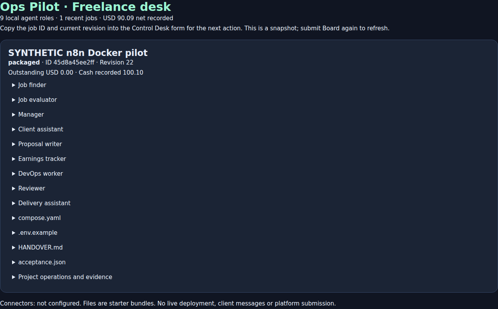

# Agency continuation validation

**Baseline: all seven CI jobs passed on implementation commit `782a8aa428d6872e49f83d2924485ec7c321abe9`: [run 40047437636](https://github.com/Vishnu063/ops-pilot/actions/runs/40047437636).** That result applies to the prior baseline; the new business-assistance continuation is tracked below. Work continues on `feat/freelance-agency-studio` in [PR #4](https://github.com/Vishnu063/ops-pilot/pull/4); main was not updated or merged.

The [50-step roadmap](AGENCY-ROADMAP.md) records **32 verified in repository/synthetic scope and 18 prepared/documented**. This is not a claim that 50 customer actions occurred or that the agency is production-ready.

## Observed results

| Check | Result and evidence | Boundary |
| --- | --- | --- |
| Local Python suite | 47 discovered, 43 passed, four opt-in Docker cases skipped | Skips are not passes. Tests use real local HTTP/SQLite; most Docker failures are simulated. |
| CI Python 3.11/3.12/3.13 | All passed, including installed CLI/setup smoke, syntax and workflow structure | Single-owner software; no hostile tenant security claim. |
| Original Docker lab | Three actual container/recovery cases passed in CI | Preserves the pinned monitoring engine and separate repair approval. |
| Generated-bundle Docker lab | Actual generated Compose config/start, healthy HTTP 200, unhealthy endpoint deadline and ownership-checked cleanup passed | Practice runtime only; both cleanups verified. No customer target accessed. |
| Desktop/mobile browsers | Original monitor and agency journeys passed; nine roles, separate approvals, invoice record, ZIP, no page errors or mobile overflow | Synthetic listings; original monitor uses simulated Docker. Screenshots were visually reviewed. |
| Real systemd lab | Detached start and crash recovery passed | Disposable CI host, no customer service installation. |
| Real n8n 2.44.6 | Authenticated production form, five planning roles, owner decisions, worker/reviewer, delivery, business record/payment, board, stale refusal and binary ZIP response passed | Disposable isolated CI runtime with synthetic credentials/data; no existing account configured. [Result](evidence/n8n-acceptance.json). |
| Business/approval tests | Per-project/currency balances, exact cents and labor rounding, duplicates, role denial, scope freeze, changed-evidence invalidation, expiry, closure and concurrency passed | Owner records are not proof of consent, identity, acceptance or money. |
| Backup/restore | Consistent embedded-artifact snapshot, private modes, integrity/hash, tamper refusal and fresh-destination restore passed | Restored approvals cleared. Original monitor and n8n credential/volume backups are separate. |
| Lab failure controls | Simulated timeout, interrupted restart/recovery, failed cleanup, foreign ownership and different-daemon refusal passed | These failure simulations are not real Docker timeout/host-failure evidence. |
| Synthetic pilot | Nine roles, business/financial records, customer-acceptance/offboarding simulation, closure and restoration passed | [Report](evidence/synthetic-pilot.json); no real customer or money. |
| Optional AI | Adapter is bounded, cached, has no execution/tools/paid fallback; missing-model refusal tested | Local Ollama service was unavailable; no model downloaded, quality benchmark, token/cost saving or real model acceptance claimed. |

The compatible unprivileged Docker fixture uses port 8080; see [its upstream documentation](https://github.com/nginx/docker-nginx-unprivileged). The worker still requires an explicitly allowlisted immutable image already present locally and a local Unix Docker daemon. It never pulls/builds images. Its lab approval is persisted as consumed before side effects; recovery requires the recorded original daemon/endpoint and refuses an active process or foreign resources.

This is a real rendered n8n completion response, not a live canvas or the owner's account. Figures are synthetic ledger entries. The earlier SVG remains a generated canvas overview. The current agency desktop/mobile screenshots came from the passing CI run and were reviewed before delivery.

## Reproducible checks and purpose

Activate the repository virtual environment first so its installed `ops-pilot` command is on PATH.

- `python -m unittest discover -s tests -v` checks persistence, local HTTP authentication, approvals, accounting, revision history, backup and failure controls. Opt-in Docker cases skip without an owned disposable host.
- `python scripts/installation_smoke.py` checks the installed CLI, private setup and cancellation behavior.
- `python -m compileall -q ops_pilot scripts tests` parses Python; `bash -n start.sh scripts/install-service.sh` parses shell without running services. Extract each dashboard script and use `node --check` to parse its JavaScript; this is not visual acceptance.
- `python scripts/build-freelance-workflow.py` regenerates the inactive credential-free workflow. `python scripts/check-freelance-workflow.py` checks structure, expression boundaries and credential roles; neither replaces runtime acceptance.
- `python tests/browser_acceptance.py` and `python tests/freelance_browser.py` exercise real Chromium desktop/mobile sessions against local HTTP/SQLite.
- `OPS_PILOT_GENERATED_LAB=1 python -m unittest discover -s tests -p test_generated_bundle_lab.py -v` runs actual Compose acceptance only on a disposable owned Docker host. The test setup explicitly pulls its public fixture; the worker does not.
- Set `N8N_EXECUTABLE` to an isolated n8n 2.44.6 executable and run `python tests/n8n_acceptance.py` under Node 24 to exercise real forms, bridge and ZIP. It creates a private temporary n8n instance with generated credentials, then stops it. Do not point it at an existing account/state directory.
- `python scripts/synthetic-pilot.py` regenerates the labelled report/example files using temporary state; it deploys nothing and records no real money.

## Inspection and resolved failures

Inspection confirmed a clean feature head `fe83251a20ce8c42843c111222a183573010743a`, open/unmerged PR #4, and the earlier [passing foundation run](https://github.com/Vishnu063/ops-pilot/actions/runs/40023644211). The historical untracked drafts were absent; the new modules implement their described requirements, rather than claiming recovery of those drafts.

Validation found and corrected mobile overflow, an incompatible stock nginx fixture, n8n Form Trigger completion mode, execution persistence needed by completion polling, and an expression terminator in the worker route. Real n8n acceptance caught errors that CLI import/structural checks had missed. The passing run above follows those corrections.

The local macOS sandbox refused Chromium Mach-port registration, so visual/browser acceptance ran in Linux CI. Local Docker/systemd were unavailable. Disposable local n8n installation encountered network failures and disk exhaustion; only task-owned test runtimes/caches were removed. An unexpected workspace-directory removal also occurred; its cause was not established. Authored changes were recovered from this chat's command log onto a fresh clone and checkpointed in Git. Final verification applies to that recovered tree; no existing n8n installation or customer data was changed.

## Remaining external dependencies

The owner's actual n8n/backend instance still needs its private credentials, import/setup and operational acceptance. n8n Form Ending needs saved successful execution status; keep it private and configure pruning (the optional Compose example uses seven days). Back up n8n volumes and encryption key separately.

No real client, signed agreement, verified authorization/access, customer target, reviewed customer delivery, actual acceptance, bank receipt or paid pilot was supplied. Those actions remain pending. No proposals/messages were sent, services publicly exposed, payments collected or customer infrastructure changed. Owner-entered references and synthetic tests cannot establish those facts. Optional model service/weights/license acceptance and later-service workers remain unverified/gated. Deferred repository decisions and unresolved licenses/Strata identity are recorded in [the selective inventory](REPOSITORY-DECISIONS.md).

## Business-assistance continuation

Adds deterministic owner-only quote calculation, requirements/intake inspection and saved requirements/progress/incident/overdue/follow-up drafts. No customer account, infrastructure, messaging or payment service is connected. Six new regression tests passed, including rounding/limits, quote approval invalidation and freeze, expired/unsupported requirements, manual-review-only readiness, per-project balances and owner-only unsent drafts.

Current local full suite: 53 discovered, 49 passed, four Docker cases skipped. Installed CLI/setup smoke, Python/shell/JavaScript syntax and workflow structural/credential checks passed. The synthetic pilot now exercises a 100.10 estimate, complete synthetic intake and all five unsent draft types; those records remain explicitly synthetic. Browser and real n8n acceptance have been extended for all three new actions; their current CI run remains pending. Previous passing CI results do not verify these new code paths.
