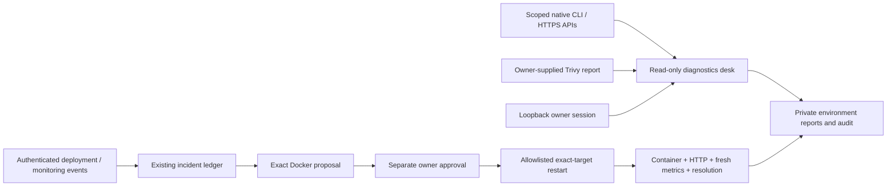
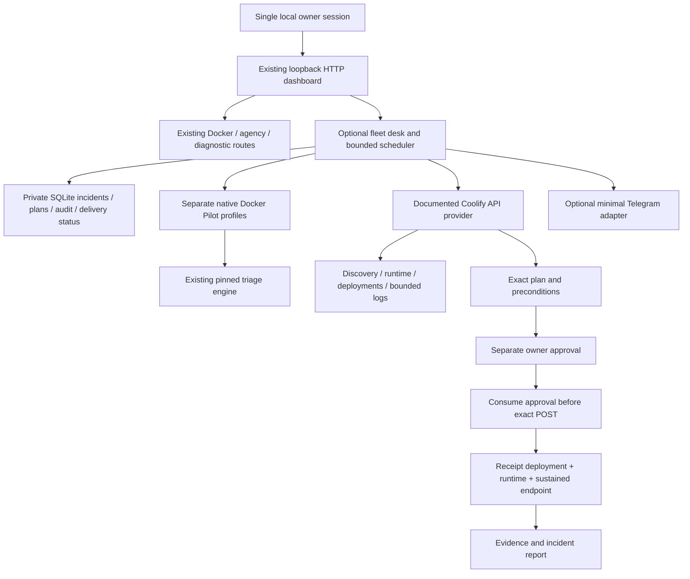
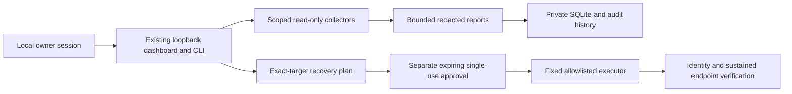

# Architecture and reuse

Ops Pilot is a small Python-standard-library orchestrator/UI on top of a pinned
first-party dependency, DevOps Triage Assistant. Its immutable source reference
is declared in pyproject.toml. It is a dependency, not a fork or vendored copy.
No third-party code/models have been copied into this repository.

The monitor requests only read-only endpoint checks and incident collection.
An outage edge triggers one deep scan; repeated failed probes do not flood the
incident store. Manual investigation permits a new snapshot. A process-local
lock serializes monitoring and user actions. Only one Ops Pilot process should
manage a given state directory/target; there is no distributed leader election.

The existing ExperienceEngine and ToolEngine preserve exact plans, five-minute
expiry, approval/application separation, state fingerprint validation, consumed
approvals and state-plus-application verification. The Docker adapter includes
observed daemon identity in the fingerprint and executes against the captured
immutable container ID rather than a mutable container name. Final verification
checks that same ID/daemon. There is still a race if an operator retargets a Docker
context between identity validation and dispatch; freeze context configuration
and use one incident owner. No claim of atomic distributed transactions is made.

Restart is a fixed operation with bounded timeout, never AI-written shell code.
Timeout/interruption does not trigger a retry. An executing plan remains consumed;
inspect Docker state and history before issuing another authorization. No UI
button overrides this latch.

Health is two consecutive HTTP 200 probes out of three, with three-second request
timeouts and one-second intervals. Redirects are rejected. This can reject a slow
startup and does not test business transactions. HTTP and Docker may fail for
different reasons; the UI keeps evidence and hypotheses separate.

Optional upstream AI receives only filtered codes/metrics/signature counts and
health flags through numeric loopback HTTP, not raw logs or topology. This limits
its reasoning and does not establish root cause. Its output never enters the
command router. New AI providers must not silently change these data boundaries.

The dashboard is loopback-only with a fresh random startup token, HttpOnly
SameSite cookie, strict Host checks and Origin checks on mutations. It serves no
external scripts, styles or tracking. Configuration changes are local file/setup
operations, not web API input. One owner's processes are trusted; this is not a
multi-tenant authentication boundary. Browser reconnect/restart requires a new
login link. A leaked terminal link grants local/tunnel dashboard access.

Only approved, supported repairs may execute. There is no Uptime Kuma integration,
HolmesGPT integration, queue infrastructure or system service in this milestone.
Adding them would require real integration tests, permission/data-boundary review
and scope-specific documentation rather than broad compatibility claims.

## Daily operations (0.2)

`runtime.py` stores monitor controls and bounded alert delivery history in private
`monitor.sqlite3`, keyed by context/container/health URL. Timed maintenance probes
health but suppresses automatic investigation/alerts and blocks repair actions;
entering it cancels an outstanding pending/approved plan. Pause is persistent.
Webhook attempts commit before I/O, send only source/event, reject redirects and
proxies, and never retry automatically. A process crash can lose a delivery;
`attempting` is ambiguous. No delivery guarantee is claimed.

`/api/report` is an authenticated attachment built from the same filtered state.
No webhook destination, login token, raw inspect payload or raw log content is
included. The Docker parser adds RestartCount to the existing filtered projection.

`system_service.py` renders a fixed nonroot systemd entrypoint, with path/user
validation; the explicit installer refuses an occupied default port. It never
runs package installation at boot or alters an app container's startup policy.
Systemd restarts the monitor on failure; it does not approve/replay application
repairs. A full host reboot and production deployment still require host-specific
validation. See README for private journal/tunnel access and removal.

## Read-only diagnostics beside approved recovery

The diagnostics desk has no repair endpoint and cannot issue shell commands from requests. Native read credentials, source/read keys and owner approval are different capabilities. Environment IDs separate reports for a trusted owner; they are not a multi-tenant isolation claim. See [self-hosting](SELF-HOSTING.md).

## Optional application fleet / Coolify

No provider is mandatory. Coolify reads are independent from native Docker mutations. Configured app IDs/instance UUIDs bind actions; unknown versions cannot mutate. Shared tenant hosting and arbitrary command execution are absent. Additional Docker profiles retain the original engine's verification rather than translating remote API approvals. See [fleet runbook](coolify/OPERATIONS.md) for trust boundaries, cross-controller races, crash reconciliation and retention limits.

## Owner-only storage and optional resource evidence

Ops Pilot's monitor, diagnostics, fleet and agency databases now share private-file preparation. Linked/non-regular database or journal files and symlinked directory components are refused; the leaf state directory and files are restricted to 0700/0600. Preparation is repeated before each connection. SQLite transaction contexts close connections deterministically, including error/rollback paths. This is POSIX owner isolation, not tenant isolation: a process under the same UID or root can still race or alter state. The pinned native engine's storage is not replaced by this helper.

The optional `docker` diagnostics profile uses the existing immutable-container/daemon adapter. `metrics: true` adds a fixed bounded `docker container stats` read against that container ID and reinspects identity afterwards. It reports Docker CPU percentage relative to one logical CPU and memory percentage/usage relative to the reported limit. One sample is evidence, not proof of sustained resource exhaustion or successful recovery. Stats failures remain inconclusive. No stats or diagnostic operation can approve or execute repairs.
