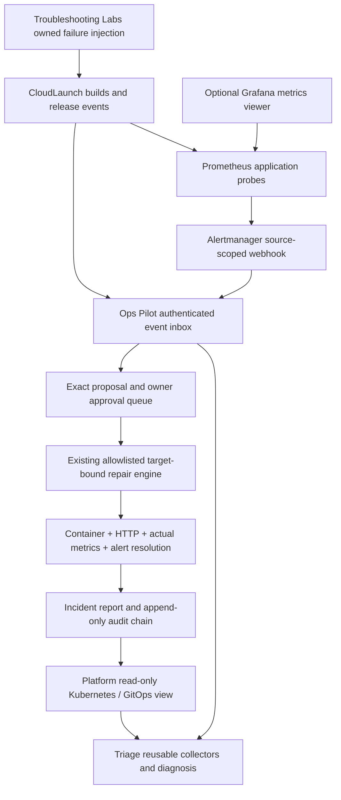

# Optional unified DevOps ecosystem

This continuation preserves the agency feature ancestry and the original monitor. It does not merge unrelated PRs or update main. [The five-repository audit/reuse matrix](ECOSYSTEM-INVENTORY.md) identifies existing owners and components before integration changes. Auto-Youtub and unrelated repositories are untouched.

## Lightweight startup and configuration

All integrations are opt-in. Keep the existing application configuration and standalone setup in this README. Install Ops Pilot's exact pinned Triage dependency, then add `--ecosystem-service ecosystem-demo` to the existing `ops-pilot serve --config /private/config.json --state-dir /private/state` command. This starts the same loopback server with the optional inbox; it provisions nothing. `config.json` still names one exact owned Docker context/container and health endpoint. It is never replaced by incoming event data.

`python scripts/setup-ecosystem.py /private/new-ecosystem` creates a new private directory, separate source/read credentials, monitoring data directories and an owner-only integration.env; it refuses an existing destination and prints no keys. Load that file into the local service/Compose environment through your protected configuration process. It starts no services and does not replace existing credentials.

Configure long distinct credentials through protected environment values:

| Variable | Purpose / capability |
| --- | --- |
| OPS_PILOT_EVENTS_CLOUDLAUNCH | CloudLaunch deployment-event ingestion only |
| OPS_PILOT_EVENTS_PLATFORM | Optional Platform event ingestion only |
| OPS_PILOT_EVENTS_ALERTMANAGER | Alertmanager ingestion only |
| OPS_PILOT_EVENTS_LABS | Optional controlled-lab event ingestion only |
| OPS_PILOT_READ_TOKEN | Read-only `/integration/state` and `/metrics`; cannot authorize actions |
| OPS_PILOT_PROMETHEUS_URL | Configured local HTTP or HTTPS Prometheus base URL for actual recovery queries |
| OPS_PILOT_PROM_JOB | Explicit application-probe job, default ecosystem-app |
| OPS_PILOT_K8SGPT | `1` opts in to an already installed deterministic analyzer; otherwise disabled |
| OPS_PILOT_K8SGPT_CONTEXT / OPS_PILOT_K8SGPT_NAMESPACE | Exact read-only Kubernetes scope; no inferred cluster |

Use the startup login capability to open `/ecosystem`. The backend owner session plus exact Origin/Host checks protect `/api/ecosystem/action`. Source/read tokens never authorize this endpoint. The owner selects an incident, collects evidence, creates the exact plan, approves/rejects it, and separately executes it. No broad shell, automatic production changes, infrastructure deletion, unbounded retries or automatic rollback is introduced. Existing CloudLaunch rollback behavior remains owned by its pipeline and is separately documented there.

`POST /webhooks/ecosystem` accepts only v1.0 DeploymentEvent or MonitoringAlert, matching the credential's source and configured service. `POST /webhooks/alertmanager` requires its dedicated source token and matching service/fingerprint labels. No browser Origin is accepted for these server-to-server routes. Payloads are at most 64 KiB; rate limit is 120 requests/source/minute and event retention admission stops at 10,000 rows for owner archiving. Credentials must be at least 32 characters and distinct. TLS is required except on loopback. Keep services private, normally via existing SSH tunnels; no public endpoint or cloud security group is configured by this work.

Idempotency uses stable source/event IDs and rejects ID collisions with changed payloads. Alertmanager retries use stable firing/resolution cycle timestamps and fingerprints; a five-minute fingerprint window coalesces repeated firing notifications. Correlation IDs link release/alert evidence and incident reports, but temporal proximity is not proof that a release caused an outage. Incoming resolved notifications do not close an incident or execute a repair. A new firing cycle after verified recovery creates a new incident.

## Contracts, diagnosis, approval and verification

The canonical versioned contracts ship in the existing `triage.ecosystem` package. `python -m triage.ecosystem schema` prints JSON Schema for DeploymentEvent, MonitoringAlert, Incident, Evidence, Diagnosis, RemediationProposal, ApprovalDecision, ExecutionResult, VerificationResult and IncidentReport; it does not start a service. Programmatic `validate`, `envelope`, `diagnose`, `emit` and `verify` are reused across repositories. Native Triage findings/deep collectors/health policy remain authoritative, not a second diagnosis engine. Suggested commands describe what, why, read-only status and problem output; commands/model text never become execution inputs. Optional K8sGPT omits `--explain`, uses a fixed argv/scope and cannot execute its output or silently invoke a paid provider.

Only Docker restart for the one original configured target is executable in this integration. Kubernetes/rollout/Prometheus/error-rate values can be represented by the reusable verification interface; a missing required value is inconclusive. Live Kubernetes remediations, Jenkins job execution, GitOps sync and resource changes are not enabled by the event inbox. Use existing reviewed native workflows with their own access/policies. Plans use the existing immutable container/daemon identity, state/configuration hash, expiration, approval consumption and replay protections. The incident ledger also uses a process lock, persisted operation state and revision checks. A crash leaves interrupted/busy state visible; it never automatically retries a repair. Inspect the original engine's executing plan and target before any manual recovery; do not clear its state to force replay.

Actual default recovery checks are the original container verification, the original bounded HTTP health policy, a recent `probe_success` vector for the configured Prometheus job, and the authenticated Alertmanager resolution. An unavailable metric/endpoint or unresolved alert prevents verified closure. No configured error-rate criterion is fabricated if its metrics are missing. Future policies may use the reusable typed verifier but must supply their own observed evidence.

Reports include incident/correlation IDs, event references, diagnosis uncertainty, exact plan, owner decisions, execution/verification results, recovery duration and audit timeline. `/api/ecosystem/report?id=...` requires the owner session. The ledger is private SQLite; audit UPDATE/DELETE triggers and hash chaining detect ordinary edits, but cannot make local owner/root compromise impossible. Source payload text is redacted; do not send credentials or raw customer logs. Audit/contract/export bounds can require owner archival. The pre-existing agency backup excludes this new database: stop the service and back up the complete private state directory, including original triage/monitor state and `ecosystem/events.sqlite3`, through your approved private backup process. Restore into a fresh directory, rotate bridge/source keys, inspect/cancel old plans and re-approve only after current evidence. Never assume an old snapshot authorizes new side effects.

## Monitoring, views and resources

Platform owns the optional Prometheus/Alertmanager/Blackbox/Grafana configuration at `monitoring/ecosystem/`. Reuse existing infrastructure first. Its Docker Compose profiles start nothing by default, use separate loopback ports, bounded memory/CPU and an optional authenticated Grafana UI. Review target/service labels and private credential-file mounts before opting in. The read-only LiveFlow source displays incident status; its existing Kubernetes/Jenkins topology remains independent. Grafana is not a log storage engine. No new log backend is deployed; existing Triage bounded log-signature collection is reused. Node/cAdvisor/kube-state-metrics-dependent rules are prepared and need separate live resource/cluster acceptance.

One operation runs at a time; no message broker, background AI or large model is required. The disposable sample is capped at 64 MiB/0.25 CPU. CI measures its controller process peak RSS and elapsed recovery time and records monitoring container limits. These are not proof that all optional Jenkins/Kubernetes/Grafana/model services fit on an 8 GB host. Keep unused profiles, AI inference and cluster integrations disabled; reuse existing monitoring where available.

## Verification and remaining gates

New deterministic tests cover contract validation, private retry outbox, missing/failed verification evidence, source/service scope, idempotency across restarts, webhook inability to approve, stale/unapproved actions, append-only audit, optional disconnected Platform sources and private CloudLaunch reporting. Existing original monitor/agency/native diagnostic tests are retained.

The real acceptance driver belongs to Labs (`ecosystem/acceptance.py`): it builds/deploys the separate CloudLaunch sample, confirms real Prometheus health, stops the owned test container, waits for a real alert/webhook, collects actual evidence, creates a restart proposal, proves no repair occurs before approval, approves/applies it, verifies HTTP/metrics/alert resolution, rejects replay, displays the read-only Platform incident and exports the complete report. Its cleanup validates unique ownership before removing only its resources. Ops Pilot's ecosystem CI checks out exact producer/lab revisions and uploads result/report/cleanup evidence. Until that CI passes, this path is implemented awaiting verification; unit tests or scenario metadata are not end-to-end evidence.

Jenkins runtime/Trivy database results, customer targets/accounts, live Kubernetes/GitOps/Helm/K8sGPT, host resource-pressure/restart rules, Grafana provisioning and a full-stack 8 GB measurement remain separate external or runtime acceptance gates. No customer changes, cloud provisioning, proposals, payments or public exposure are performed. External sources screened: Prometheus Apache-2.0, Grafana AGPL-3.0, K8sGPT Apache-2.0; no upstream server source/model weights are copied or sublicensed. Optional models/providers need their own rights and explicit configuration.
