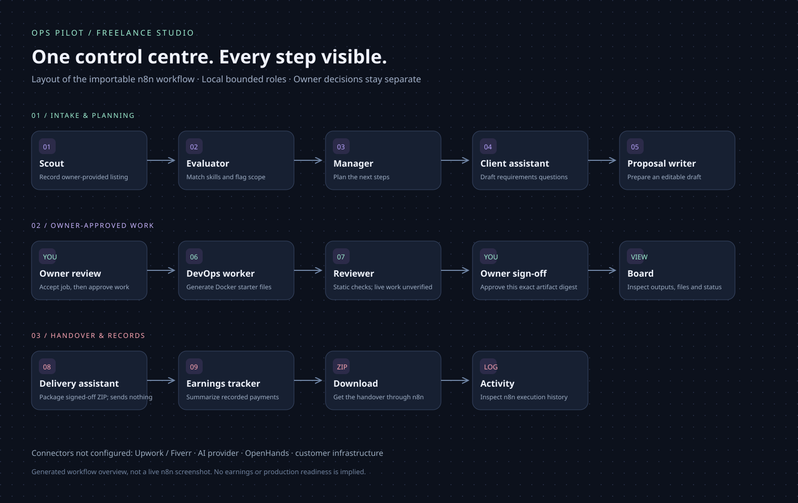

# Freelance studio and n8n control centre

Current agency additions, all 50 step statuses and subsequent evidence are in [AGENCY-ROADMAP.md](AGENCY-ROADMAP.md), [AGENCY-OPERATIONS.md](AGENCY-OPERATIONS.md) and [AGENCY-VALIDATION.md](AGENCY-VALIDATION.md). The foundation results below retain their original date.
Ops Pilot now includes a separate, single-owner freelance workspace. Its nine named roles run **bounded local automation**, not nine autonomous language models. Outputs, approvals, artifact contents, payments and revisions persist in a private SQLite database. Existing Docker monitoring and repair rules are preserved.


## What you can do now

| Role | Implemented behavior | Boundary |
| --- | --- | --- |
| Scout | Records source/provenance for a listing you provide | No platform scraping or automatic discovery |
| Evaluator | Matches DevOps keywords and flags risky scope | Score is a heuristic, not verified job quality |
| Manager | Builds a task sequence and identifies the next step | Does not accept work or promise delivery |
| Client assistant | Drafts requirements questions and a reply | Sends nothing |
| Proposal writer | Produces an editable template using matched skills | No LLM or claimed customer history; verify wording |
| DevOps worker | Generates Compose, acceptance metadata and handover instructions for an existing image | Explicit approval required; no application coding, image build, shell or deployment |
| Reviewer | Checks required files, loopback binding and bounded configuration properties | No runtime, load or complete security validation |
| Delivery | Packages the exact owner-signed-off bundle as a ZIP | No customer submission or claim of acceptance |
| Earnings | Summarizes owner-recorded gross, fees and net by currency | No collection, bank integration or currency conversion |

The first supported worker task is a **Docker deployment starter for an existing trusted application image**. Other tasks remain manual review. Kubernetes checks in `devops_platform`, Ulysses discovery and OpenHands execution are **not integrated**. No code was copied from those projects.

## See everything in n8n

Import [freelance-agency.json](../n8n/freelance-agency.json). This is one canvas with five routes and all nine roles visible:

1. **Import listing** — imports your text, then runs Scout → Evaluator → Manager → Client assistant → Proposal writer.
2. **Generate starter files** — Worker → Reviewer; blocked until client acceptance and work approval are separately recorded.
3. **Owner decision** — approve proposal, record client acceptance, approve work, sign off, package, edit proposal, reject or record payment. Earnings refreshes afterward.
4. **View board** — shows all recent jobs, IDs/revisions, every completed role's output, actual file contents and recorded earnings.
5. **Download handover** — returns the packaged ZIP through the n8n form.

Choose **Execute Workflow**, open its form, select the task and submit. A static board appears at completion. To see new changes, submit View board again. There is no continuous streaming view. Expand the details to inspect each output. The **Executions** tab shows node inputs, outputs and failures. Imported workflows are inactive; publishing them is a separate local setup action.



The diagram is a generated overview of the importable canvas, not evidence that your EC2/n8n instance is connected. See validation below for what was actually exercised.

## Set up the backend on your EC2

Use an ordinary Linux account and an existing checkout. None of these steps provision AWS resources or touch a customer application.

```bash
git pull --ff-only
```

Updates the existing checkout without creating a merge. Use it to obtain the new workspace after these changes are merged.

```bash
python3 -m venv .venv
.venv/bin/python -m pip install -e .
```

Creates an isolated Python environment and installs Ops Pilot plus its pinned Triage dependency. This keeps dependencies separate from system Python.

```bash
.venv/bin/python scripts/setup-freelance.py
```

Creates `n8n/.env` with different private workflow/owner bridge tokens and an n8n encryption key. Existing secrets are kept. The file is ignored by Git and created with mode 600.

```bash
.venv/bin/python scripts/run-freelance.py
```

Loads the two bridge tokens and starts a **loopback-only** workspace on port 8767. This mode requires no Docker target or application configuration. Leave the process running. Ctrl+C or an SSH disconnect can stop it; no background service is installed by these steps. Use a persistent server session or your existing process manager if needed.

To run the original monitoring and freelance workspace together instead, load the two bridge keys into that service's private environment and use the existing `serve` command. Do not run both processes on the same port. The existing service installer is for monitoring; it does not read `n8n/.env` automatically.

## Existing n8n or separate n8n

**Existing n8n on this EC2:** reuse it and import the JSON. Native n8n or a container using Linux host networking can reach `http://127.0.0.1:8767`. A bridge-network container's localhost is its own container; it cannot reach the host's loopback listener. Do not solve this by publicly exposing Ops Pilot. An n8n Cloud instance also cannot reach this private backend.

**Optional separate n8n on Linux/EC2:** the supplied Compose file uses host networking, binds n8n only to loopback port **5680**, and leaves an existing port-5678 installation alone. First check that 5680 is free. This mode is for Linux host networking, not a generic Docker Desktop configuration.

```bash
docker compose --env-file n8n/.env -f n8n/compose.yaml up -d
```

Starts the optional n8n instance using version 2.44.6 and a persistent data volume. It does not mount the Docker socket or customer files. It requires an existing Docker/Compose installation. It does not start the Python backend.

On your computer, use your existing SSH identity and host, adding two local forwards:

```bash
ssh -N -o ExitOnForwardFailure=yes -L 8767:127.0.0.1:8767 -L 5680:127.0.0.1:5680 -i /path/to/key.pem ubuntu@YOUR_EC2_PUBLIC_IP
```

Keeps a private connection from your computer to the EC2 loopback ports. Replace the key path, user and IP. Open the printed Ops Pilot login link and `http://localhost:5680` in that computer's browser. For an existing n8n on 5678, forward that port instead. Do not open these ports in an AWS security group. The optional n8n uses plain HTTP only inside this loopback/tunnel setup, with secure cookies disabled for that reason; this is not a public hosting configuration.

Create the n8n owner account locally if using a new instance. Import the JSON using **Import from File**. No workflow or credential has been installed into your existing account by repository changes alone.

## Three credentials to select once

The JSON contains placeholder credential references only. Create these credentials in n8n and select them on the relevant nodes:

| Credential name | n8n type | Configuration |
| --- | --- | --- |
| Ops Pilot Form Login | Basic Auth | A new private username/password for the control form; choose your own |
| Ops Pilot Workflow | Header Auth | Name: `X-Ops-Pilot-Key`; value: `OPS_PILOT_WORKFLOW_TOKEN` |
| Ops Pilot Owner | Header Auth | Name: `X-Ops-Pilot-Key`; value: `OPS_PILOT_OWNER_TOKEN` |

```bash
.venv/bin/python scripts/setup-freelance.py --show-credentials
```

Displays the two bridge secrets **only in your own terminal** so you can copy them into n8n. Do not paste this output into chat, GitHub, logs or screenshots. The n8n encryption key is not displayed. Keep a secure backup of `.env` and the n8n data volume.

The Owner credential belongs only on **Owner decision · explicit review**. All other HTTP nodes use Workflow. The Form Trigger uses Form Login. No AI provider credentials are required. Workflow credentials cannot approve or edit proposals, accept or reject jobs, approve work, sign off or record payments. n8n administrators can edit credentials/workflows and are trusted as the owner; this is not a multi-user approval system.

## First practice run

Use a clearly labelled synthetic listing, never pretend it is paid customer work:

- Task: Import listing.
- Project title: `DEMO — Docker deployment`.
- Requirements: `Prepare Docker Compose starter files for an existing image on AWS EC2 with Linux and nginx.`
- Source: `demo`; budget: `0`; currency: `USD`.

Submit and inspect the five planning outputs. Copy the **job ID and revision** shown on the resulting board. Then use the control form in this order:

| Task | Decision / data | Outcome |
| --- | --- | --- |
| Owner decision | `approve_proposal` | Records your review; submits nothing |
| Owner decision | `accept`, Confirm job ID | Records owner-reported client acceptance; for the demo, this is simulated |
| Owner decision | `approve_work`, Confirm job ID | Authorizes file generation only |
| Generate starter files | Job ID, current revision, existing application image, internal port, health path | Generates files, then performs static review |
| Owner decision | `sign_off`, Confirm job ID | Records approval of this exact artifact digest |
| Owner decision | `delivery` | Packages the reviewed files |
| Download handover | Job ID | Downloads ZIP through the n8n form |
| Owner decision | `payment`, amount, fee, unique reference | Records a received payment only if one actually occurred |

Refresh the revision after **every** operation. The n8n control route also runs Earnings, so the final board is authoritative. Replayed/stale requests are refused. An already completed planning/worker role is not silently rerun. A duplicate listing returns the existing job; do not re-import it through the full planning lane expecting new results. Use View board instead.

The original Ops Pilot dashboard also has a **Freelance studio** link. In standalone mode, the private login opens the studio directly. You can perform the same actions there with fewer form fields, edit proposals, search projects and download bundles.

## API and data

- Browser workspace uses the existing owner cookie, host checks and same-origin POST checks.
- n8n bridge uses a distinct header credential, loopback host validation, bounded JSON and no browser-origin requests.
- Agent actions require the current revision. Work approval is consumed by one generation. Delivery sign-off binds the artifact digest.
- Data is private under the selected state directory's `freelance/workspace.sqlite3`. The board shows at most 200 recent jobs and 80 events; earnings totals cover recorded payments by currency. There is no export/backup scheduler yet; back up the state directory while stopped.
- Both roles can read job descriptions and outputs. Keep client secrets out of listings and n8n executions. n8n execution data is pruned after seven days in the optional Compose setup.
- There is no running AI model, platform OAuth, SMTP sender, payment gateway, OpenHands worker or arbitrary shell execution. Those connectors require separate implementation and real integration checks.
- There are no guaranteed earnings. The ledger is a record you enter, not proof of money received.

## Validation

See [FREELANCE-VALIDATION.md](FREELANCE-VALIDATION.md) for observed local results and remaining setup. Docker/service lab results remain separate from the new freelance checks.
