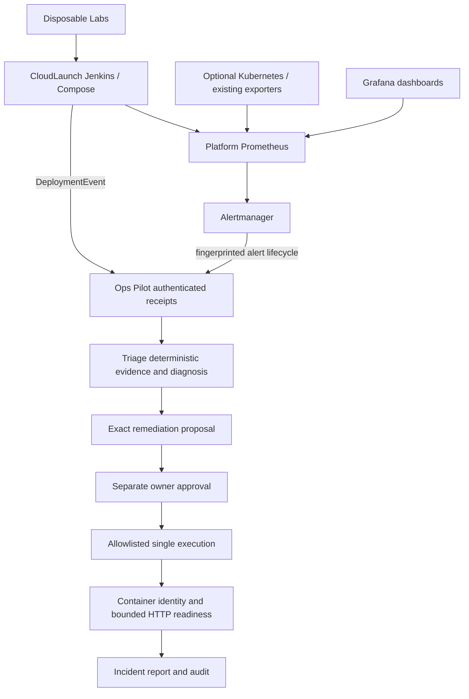

# Optional unified DevOps ecosystem

CloudLaunch owns deployment, Platform owns Kubernetes/GitOps diagnostics and monitoring, Ops Pilot owns incident coordination and approval, Triage owns reusable analysis/verification, Labs owns controlled faults. See the [inventory and reuse matrix](INVENTORY.md). Each repository still works independently.



## Enable event intake

Ops Pilot remains one configured Docker application, one local owner and a loopback dashboard. It is not a multi-user control plane. Finish normal `setup` first. Run with an independently generated `OPS_PILOT_INGEST_TOKEN` of at least 32 non-whitespace ASCII characters, injected securely into the server and producer processes. No key value belongs in Git or examples. Without this variable, intake and machine metrics access are disabled. The machine bearer cannot authenticate to owner approval routes. Owner sessions cannot substitute for machine credentials.

```sh
# With the private environment variable already configured:
ops-pilot serve --config /private/config.json --state-dir /private/state --port 8767
```

`POST /api/events` accepts at most 64 KiB and 50 Alertmanager v4 alerts. Browser Origins, transfer encoding, unknown deployment fields, unsupported versions, conflicting IDs and foreign services are refused. Alert labels must include `service` exactly equal to the configured container name and `alertname`; annotations, remote URLs and commands are not trusted or executed. All messages are validated before a batch is recorded. Ingestion never plans, approves, executes or declares recovery.

`GET /metrics` uses the same machine bearer and reports endpoint-known/healthy, unique receipts, investigated incidents and deployment status counts. No unbounded service/incident-ID metric labels. `ops_pilot_endpoint_known=0` distinguishes unknown from failed. Existing owner login/session, Host and Origin protections remain enforced. The dashboard shows incoming receipts; its existing plan/approve/run controls remain separate. The approval queue supports one active plan for this one target, expires after five minutes, binds exact daemon/container/state/health policy, and refuses consumption twice. Maintenance prevents planning/approval/execution; it can record receipts without investigating until retried after maintenance.

## Delivery, correlation and persistence

Deployment producers send complete version 1 `DeploymentEvent` objects using [the canonical schemas](../../contracts/v1.schema.json). Use `python /path/to/ops-pilot/ops_pilot/events_client.py --help`; this stdlib client needs no Docker, AI or Triage installation. Configure `OPS_PILOT_EVENTS_URL` with the exact endpoint and keep its token in a secure environment binding. HTTPS is mandatory except loopback. Redirects are refused. It retries three times for transient failures, reusing the same ID, timestamp and body. Local JSONL audit happens before sending. Omit the URL for a local-only producer.

Receipts persist in the existing private monitor SQLite database before investigation. Exact duplicate IDs return the stored receipt across restart; conflicting contents fail. Alert deduplication identity is `(fingerprint, startsAt, status)`, so repeats cannot create repeated investigation while a new outage with a new `startsAt` is retained. Firing/resolved lifecycle records correlate to the original incident. Deployment failures sharing source/correlation ID reuse a linked investigation for a five-minute window. A duplicate without a linked investigation can retry incomplete collection; receipts alone do not imply diagnosis success. Busy work returns a retryable error without recording a successful investigation.

Resolution messages are facts from monitoring, not recovery authority. Only the approved engine's real runtime and application probes establish verified recovery. `verification_timeout_seconds` in Pilot config defaults to 30, accepts 1–60, and is included in the health-policy binding. Bounded readiness polls never rerun a repair or initiate a rollback. Verification stops after its deadline (one in-flight request can take its remaining bounded timeout), requires consecutive successes and reports failure truthfully. Misconfigured/unreachable HTTP remains `needs_attention` even if Docker restart succeeded.

Reports include original incident timeline, filtered before/after evidence, receipts, owner action audit, plan, result and versioned contract projections. SQLite audit is append-only through the application but is not tamper-proof against the local filesystem owner. Back up/protect state yourself; there is no compliance-grade external audit retention or customer RBAC. Stored receipts are not automatically purged. The owner can export the private report through `/api/report`; never share it without checking target identifiers and URLs.

## Shared contracts

The schema file defines all ten requested records. DeploymentEvent and Alertmanager v4 are input protocols; MonitoringAlert is the normalized alert record. Incident, Evidence, Diagnosis, RemediationProposal, ApprovalDecision, ExecutionResult, VerificationResult and IncidentReport are output projections over the existing engine, not additional execution APIs. ApprovalDecision is never accepted from a webhook. The original engine schema remains available for backward compatibility. Missing evidence does not become a confirmed root cause. Recovery duration is nullable when not measured; sample latency is not incident recovery time.

Triage's `triage.ecosystem.diagnosis(report)` preserves finding evidence references and uncertainty with AI off. Its optional `k8sgpt(adapter, enabled=True)` reuses the bounded native transport for deterministic namespace analysis with explicit context and namespace, never `--explain` or execution. Requires an already installed compatible K8sGPT binary and read-only Kubernetes RBAC. Live K8sGPT was not exercised here. Existing native Triage commands remain the diagnostic interface; no arbitrary remote command endpoint is added.

## Monitoring and resources

Reuse Platform's existing node/cAdvisor scrape/exporter configuration and Grafana provisioning. The optional `monitoring/ecosystem` templates add CloudLaunch/Pilot scrapes, application readiness alerts, Alertmanager bearer routing, optional restart/resource-pressure rules and a dashboard. Render placeholders to a private directory, never source control. Pilot stays a host loopback process; the lab runs monitoring binaries as bounded-lived host processes so no public listener or Docker host networking is required. Grafana is visualization; logs remain Triage's bounded signatures or an explicitly configured existing log backend.

Do not start all components by default. No model, Kubernetes cluster, Jenkins controller, host exporter or Grafana server starts when a Python package is installed. The disposable app/database each cap memory at 192 MiB and CPU at 0.5. The monitor uses one worker and a nonblocking operation lock. A measured app snapshot is not a whole-stack 8 GB capacity guarantee. Host monitoring processes need separate systemd/cgroup limits for continuous operation. The local owner Docker privilege is powerful; public exposure, customer separation and production automation are outside this preview.

## Test evidence and limits

See [validation](VALIDATION.md) and [Labs runner](https://github.com/Vishnu063/devops-troubleshooting-labs/tree/feat/unified-devops-ecosystem/integrations). Controlled failure evidence must include real alert firing and resolution, denied unapproved execution, one approved restart and live HTTP/database verification. Optional Kubernetes, Argo CD, Helm, K8sGPT, Grafana UI and security-scanner operations are not established by the Docker lab. Prometheus application alerts were exercised; resource/restart rules require their exporters and separate controlled faults.

For a stalled startup, inspect private monitoring/app logs and readiness rather than increasing repair retries. For 403 check the machine token, Host, absent browser Origin and exact service label. For 400 check schema, lifecycle fields and reused ID contents. For 503 wait for the current operation and retry the identical body. For a failed verification, inspect the actual app and dependencies; do not reuse consumed approval.

## Reproduce in CI

The manual `Disposable ecosystem acceptance` GitHub Actions workflow checks out the four peer repositories at the immutable revisions in `revisions.json`, prepares digest-pinned monitoring tools and runs the same disposable acceptance. It does not run by default or claim a hosted CI result merely from being added. Current evidence is the actual local managed-cloud and Jenkins runs above. `scripts/prepare_monitoring_tools.py --tools /private/tools` is repeatable, checks its source manifest and binary hashes, and refuses to overwrite a different existing tool.
